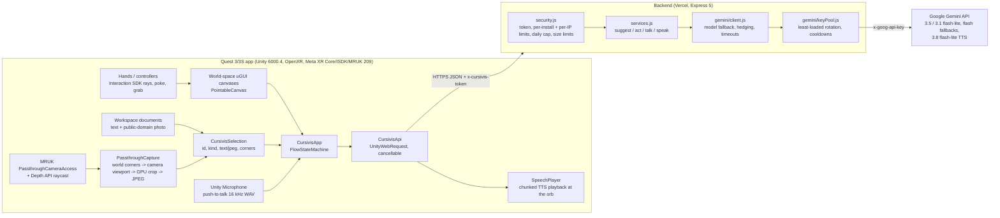

# Cursivis Spatial — Architecture

Two parts: a native Unity app for Meta Quest 3/3S (OpenXR + Meta XR SDK 209) and a small stateless HTTPS backend
(Node 22 on Vercel) that holds the Gemini keys. The headset never sees a model key.

## Quest client modules (`unity/CursivisSpatial/Assets/Cursivis/Scripts`)

| Brief's module | Implementation | Responsibility |
|---|---|---|
| SelectionManager | `Core/CursivisTypes.cs` (`CursivisSelection`), `Selection/SelectionInput.cs`, selection code in `App/CursivisApp.cs` | One normalized selection for camera and workspace content; unique id per selection; world corners for anchoring |
| PassthroughCaptureService | `Capture/PassthroughCapture.cs` | Permission, camera lifecycle (on only while snipping), world→viewport projection with the frame's camera pose, padding for parallax, GPU crop, async readback, ≤1024 px JPEG, empty-frame rejection |
| GestureInputController | Interaction SDK rig + `PointableCanvasModule`; gesture routing in `CursivisApp` + `FlowStateMachine` | State-aware routing: buttons are inert in states where they don't apply; tracking-loss handling |
| OrbController | `UI/OrbView.cs` + `Resources/Shaders/CursivisOrb.shader` | Moods Idle/Acknowledged/Understanding/Listening/ProcessingVoice/Processing/Speaking/Completed/Error |
| SuggestionPanel | `UI/OrbHud.cs` | Four AI suggestions + Talk, loading placeholders, error state, home dock |
| ResultPanel | `UI/ResultCard.cs`, `UI/MarkdownTmp.cs` | Header controls, rich body, scroll, chips (uncertainty/evidence), follow-ups, footer, loading/error, reveal, grab handle |
| VoiceController | `Voice/Voice.cs` (`VoiceCapture`, `SpeechPlayer`, `Wav`) | Push-to-talk + hands-free tap mode, VAD, muted-mic detection, WAV encode; chunked read-aloud with prefetch |
| ConversationSession | `Core/CursivisTypes.cs` (`ConversationSession`) | History per selection id (max 8 turns) + separate general history; last-selection summary for "what did I just select?" |
| SettingsController | `UI/CursivisTheme.cs` (theme persisted in PlayerPrefs), `Core/CursivisConfig.cs` | Light/dark theme; backend URL/token/build label injected at build time |
| Metrics | `Core/CursivisMetrics.cs` | Measured latencies, counters, FPS, memory → `[CursivisMetric]` logs + `cursivis-metrics.json` |
| Test harness | `App/CursivisAutopilot.cs` | Desktop-only scripted scenarios through the same app methods (`--cursivis-autopilot`) |

Scene construction is code: `Editor/SceneBuilder.cs` creates the OVRCameraRig + OVR comprehensive interaction rig
(`OVRQuickActionsAPI`), passthrough underlay, `PassthroughCameraAccess` (disabled until needed), depth manager, all
world-space canvases with Interaction SDK ray/poke wiring (`QuickActionsAPI`), the grabbable result card and the app root.
`Editor/ProjectSetup.cs` configures player/XR/URP settings and runs the Meta Project Setup Tool's FixAll headlessly.
`Editor/CursivisBuild.cs` builds the Windows simulator player and the Quest APK.

## Backend modules (`backend/src`)

| Brief's service | Implementation |
|---|---|
| ContextUnderstandingService + SuggestionService | `services.suggest`: one structured Gemini call returns content type, title, summary, quality, confidence and four suggestions (JSON schema + ajv re-validation, normalization, unsafe-action filter, labelled fallbacks) |
| ActionExecutor | `services.act`: original Cursivis per-action prompt templates + grounding rules; structured result (title, Markdown answer, evidence, uncertainty, follow-ups) |
| ConversationService | `services.talk`: audio (WAV) or typed instruction, with or without selection, transcribed and answered in one call; `clientAction` lets voice drive the app |
| VoiceService | `services.speak`: Gemini TTS → WAV (raw PCM wrapped when needed) |
| ProviderAdapter | `gemini/client.js` + `gemini/keyPool.js` + `gemini/errors.js` |

## Data and privacy flow

- A selection is created locally; nothing leaves the headset until the user pinches **Ask Cursivis**, a suggestion,
  Talk or Read aloud.
- Sent: the selected text, or the JPEG crop (≤1024 px) of the selected region only; voice audio only while Talk is held
  (or until the pause in tap mode). No continuous camera or microphone streaming.
- The backend is stateless: no database, no storage of images, audio or text. Logs contain timings, model names and
  error categories only (`CURSIVIS_LOG_REQUESTS`), never content or keys.
- Gemini API keys live only in Vercel encrypted environment variables (and a gitignored local `backend/.env`).

## Abuse and cost limits (backend/src/config.js)

| Limit | Default | Env var |
|---|---|---|
| Client token required | yes | `CURSIVIS_APP_TOKENS`, `CURSIVIS_REQUIRE_TOKEN` |
| Requests per install per minute | 40 | `CURSIVIS_RATE_LIMIT_PER_MINUTE` |
| Requests per IP per minute | 80 | `CURSIVIS_IP_RATE_LIMIT_PER_MINUTE` |
| Requests per day (per instance) | 6000 | `CURSIVIS_DAILY_REQUEST_CAP` |
| Image / audio / text size | 2 MB / 3 MB / 24k chars | `CURSIVIS_MAX_IMAGE_BYTES`, `CURSIVIS_MAX_AUDIO_BYTES`, `CURSIVIS_MAX_TEXT_CHARS` |
| Body size | 7 MB | `CURSIVIS_BODY_LIMIT` |
| Deadlines | suggest 16 s, act/talk 50 s, TTS 40 s, attempt 22 s | `CURSIVIS_*_DEADLINE_MS` |

The client token ships inside the APK, so it is not a secret; it identifies the app and lets limits apply per build.
Rotation: add a new token, ship, remove the old one.

## Model routing and resilience

### Model choice (measured, 2026-11-14 free-tier probe, act-sized prompt)

| Model | Latency (thinking minimal / low) | Role |
|---|---|---|
| gemini-3.5-flash-lite | 2.2 s / 1.2 s | primary for everything |
| gemini-3.1-flash-lite | 1.5 s / 1.4 s | hedge (different model family, independent load) |
| gemini-3.5-flash | 15.1 s / 19.6 s | late fallback only |
| gemini-3.6-flash | 43.8 s / 30.6 s | last resort |

An interactive headset UI cannot wait 15-40 s, so the larger models are only reached when both flash-lite models fail.
The flash-lite answers passed the same live grounding tests (`npm run test:live`).

- Fast chain (suggestions): `gemini-3.5-flash-lite → gemini-3.1-flash-lite → gemini-flash-lite-latest → gemini-3.5-flash`, thinking `minimal`.
- Quality chain (act/talk): `gemini-3.5-flash-lite → gemini-3.1-flash-lite → gemini-3.5-flash → gemini-3.6-flash`, thinking `low`.
- TTS chain: `gemini-3.8-flash-lite-tts → gemini-3.8-flash-tts → gemini-2.5-flash-preview-tts`.
- Per attempt: 22 s timeout. 403/401 disables the key for 6 h; 429 cools the key for the server's retryDelay (default 60 s);
  503 marks the model overloaded for 45 s and moves down the chain; a timeout also moves down the chain (a slow model
  tends to stay slow); 400 retries once without thinking/schema; invalid JSON output moves to the next model; safety
  blocks are not retried.
- Hedging: if the first attempt hasn't answered after 3.0 s (suggest) or 3.5 s (act/talk), a second attempt starts on
  another key and the next model. From then on two attempts stay in flight: if one fails while the other is still
  running, a replacement starts immediately. The first valid answer wins and the others are aborted.
- Effect: actions went from 7.7 s (auto3, gemini-3.5-flash first with a 6 s hedge) to 1.3-2.6 s (auto4).
- Caches: suggestions and action results per selection fingerprint for 10 minutes (regenerate bypasses).

## Build and deploy

- Quest APK: `tools/build-apk.ps1 -VersionCode <n>` (production backend URL, client token from `backend/.env`, release
  signing from a keystore outside the repo whose password is stored DPAPI-encrypted). Before building it re-applies the
  Android OpenXR features (Meta Quest Support, not the deprecated Oculus Quest feature) and runs Unity's OpenXR project
  validation with automatic fixes.
- Simulator player: same with `BuildWindows` / `StandaloneWindows64`, then `tools/run-sim.ps1`.
- Backend: `cd backend && vercel deploy --prod` (env vars set once with `vercel env add`).
